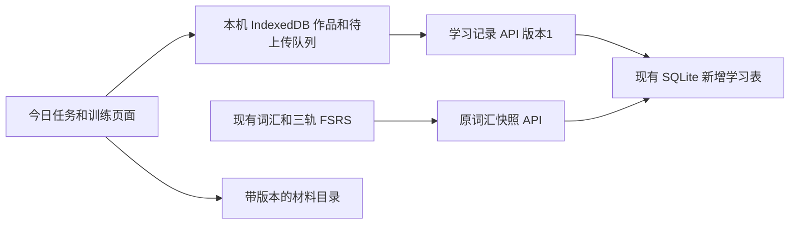

# BandGalaxy 365天全科学习融合实施方案

状态：初版实施参考。编制日期：2026-11-03，时区：Asia/Shanghai。用户已确认365天8分目标、独立SQLite及逐阶段GitHub交付；当前阶段顺序与验收以[重设计方案](./365-training-redesign-2026-11-03.md)为准。

本方案把365天学习计划接入现有雅思星图，使学习者每天能完成词汇、听读和表达任务，保存原始成果，并在手机与电脑之间继续学习。实施采用独立学习记录模块，沿用现有账号、SQLite和词汇引擎；先交付连续14天可用的学习闭环，再扩展专项训练与全年材料。

代码基线为用户指定的 [V1.2.0-11.3](https://github.com/fangxintai-a11y/yasiENGLISH/tree/V1.2.0-11.3)，对应提交 `f3384e35719b19f38e515f9cb8cfaca7c408f78f`。本文件保留初版设计；P1独立数据通路已开发，其余功能与材料仍按阶段实施。当前交付状态见[P1交付记录](./365-p1-delivery.md)。

## 1 实施目标和范围

### 1.1 用户目标

学习者目前自述为简单句能理解、较长文章吃力、很多单词不认识，没有可靠的雅思基线成绩。用户确认的项目目标为学习365天后取得雅思学术类总分8.0及以上，并保留每个单项至少6.5的约束；7和7.5只作为中间里程碑。

每天可投入120至180分钟，标准展示为120分钟核心任务，加30或60分钟选练。365天定义课程周期；材料难度和报考准备度由测评证据决定。计划分钟、实际分钟、任务完成和考试成绩分别记录。

### 1.2 原六大模块的交付安排

| 原模块 | 首期可用版本 | 后续完整融合 |
| --- | --- | --- |
| 听力语料与盲打 | 复用星图听写；新增整段短听力、首答记录、文本查漏和错因 | 扩充听力四部分的题型、整套限时测评；按表现选择听写难度 |
| 同义替换 | 复用现有词典同义练习；在阅读复盘中标明审校后的等价、单向概括或对比关系 | 新增独立语境配对训练；泛化题目适配后接入独立FSRS卡，扩展短语、范围、因果、限定词 |
| 句型训练 | 基础句型拼接、键盘造句和改错；接受合理的多种答案 | 逐步加入从句、图表句、论证段与跨天复查；不机械要求特定复杂句式 |
| 阅读与写作实战 | 短阅读答题、证据复盘；写作原稿、修订和反馈归档 | 长篇阅读、完整Task 1/2、分项计时和桌面模拟界面 |
| 口语与AI反馈 | 录音、回听、手动转写；安全的Prompt复制与反馈回填 | Part 1/2/3随机追问、一个直连AI适配器，再按需求增加其他提供方 |
| 错题与复习 | 从真实错误生成复习入口；当场修正与跨天回忆分开记录 | 统一练习队列与s/g卡排程；三连对完成本次修正，仍保留之后的复习 |

首期的“可用”须同时包含界面、材料、保存和跨设备同步。365天任务框架可以先齐备；全年已审校材料需另按库存验收，不能因界面完成就宣称全年题库完成。

## 2 学习者实际使用流程

开启365计划后，首页增加“今日全科任务”。原来的词汇学习入口继续保留，新计划由学习者主动开启。

```text
今日任务  计划第1天  正在学习基础单元1
核心120分钟  可选加练30分钟

单词复习20分钟        先复习，新词最多5个
短听力25分钟          首听作答，再看文本
短阅读25分钟          讲主旨，找原文证据
句型20分钟            完成一组句型或改错
表达20分钟            写几句或录一段话
短休和记录10分钟

今日成果：原始答案、短文或录音
保存状态：已存本机 / 待同步 / 已同步 / 需要处理两份修改
```

完成一张任务卡后回到首页，可继续下一项。当天没有做完时，保留已做部分；忙碌时允许选择20至30分钟最低任务，单独记录，不算完整完成当天核心任务。

任务完成状态采用 `not_started / in_progress / completed / partial / minimum / skipped`。延期作为任务的另一个计划日期变更记录处理，不伪造原日完成。计时由用户启动和暂停，重载不自动补计离开页面的时间；手动填写分钟需标明来源。重复勾选与撤销不改变真实练习分钟。

手机采用单栏任务页，文章与题目可切换并保留滚动位置；写作时可折叠题干，优先给键盘和正文留空间。桌面可使用文章与题目双栏。界面只呈现任务、成果和有意义的保存状态，不要求初学者理解数据库版本或FSRS参数。

## 3 课程和时间规则

### 3.1 三个独立的进度概念

| 字段 | 含义 | 规则 |
| --- | --- | --- |
| `calendarDay` | 从计划开始日期计算的日历位置 | 按计划时区计算，1至365；修改日期不增加成绩 |
| `syllabusUnit` | 正在学习的单元 | 可保持、重做或切换到巩固单元 |
| `materialLevel` | 当前材料的难度标签 | 根据首答和表达表现调整，不由日历自动提高 |

计划保存 `startDate`、`timeZone`、`curriculumVersion`、预算、暂停区间和修订号。`calendarDay`为计算结果，不用多端最大值合并。重新开始计划应创建新的 `planId`，旧成果仍可查看。

### 3.2 365天课程框架

沿用已制作的365日表，在首页归并成四阶段，保留六个细分区间供排程使用。

| 首页阶段 | 日历范围 | 细分区间 | 主要训练和检查 |
| --- | --- | --- | --- |
| 基础重建 | D1至D90 | D1至30、D31至90 | 常用词、短听读、基本句型、短段落与日常表达 |
| 接入雅思 | D91至D180 | 同区间 | 听读题型、小作文、Task 2段落、口语三部分 |
| 限时整合 | D181至D270 | 同区间 | 完整分项、整篇写作、真人互动、按反馈修改 |
| 验证准备度 | D271至D365 | D271至330、D331至365 | 不同材料完整模拟、弱项复盘、末周减量和报考决策 |

生成365天时覆盖52周加第365天，测试开始日期变更、月末、闰日和不同时区。跨设备沿用计划时区，避免设备旅行后把同一天拆成两天。

D1保留起点样本；D7、D14使用不同同级材料检查。后续按30天左右的小检查，以及D90、180、270、330、365的阶段审查调整。首期短材料只输出正确数、总题数、用时、主旨和原始作品，不转换雅思总分。

可以采用自定的材料调整规则：同级陌生材料连续两次首答约80%，且能解释主旨，试高一级；连续低于约60%或无法解释主旨时保持或降级。这是产品调整规则，不是官方等级换算。未达到检查目标时替换后续两周的任务，保留日历和真实记录，重新评估后期冲刺时间。

### 3.3 普通日预算

| 任务 | 核心分钟 | 内容 |
| --- | ---: | --- |
| 词汇 | 20 | 到期复习优先；初期新增最多5个，积压时暂停新增 |
| 听力 | 25 | 整段短音频首答、查漏、重听证据 |
| 阅读 | 25 | 短文主旨、细节和证据 |
| 句型 | 20 | 一组句型、拼接、改错或短句输出 |
| 表达 | 20 | 写作或口语一项作为主要交付，按周交替 |
| 短休与记录 | 10 | 分段休息和记录实际情况 |
| 合计 | 120 | 核心预算 |

150分钟档增加一块30分钟纠错；180分钟档增加两块。选练优先重听、重读、改写、重录。专项日按完整任务替换部分小块，预算仍须求和；不每天把完整作文拆成几分钟片段。

完整听读写模拟使用180分钟专门日，替代当天普通任务，详细复盘安排次日，口语另排。正式阅读和写作分别需要60分钟，不能把两者放入65分钟；Task 2完整练习要求至少250词、约40分钟，示范段要明确标为示范段。[官方写作格式](https://ielts.org/take-a-test/test-types/ielts-academic-test/ielts-academic-format-writing)

### 3.4 与旧词汇预算的衔接

`settings.dailyMinutes`继续表示旧词汇排程预算。新全科计划独立保存 `studyBudgetMinutes`，提供120、150、180三个档位，不因旧设置达到90分钟就自动开启。

新增 `resolveVocabSettings()`，只在已开启全科计划时生成临时派生设置：词汇预算来自当天任务，新增量取用户上限与课程上限的较小值；实际复习积压仍可使新增为零。原设置值不被覆盖，也不承诺固定每天20至25个新词。

首页预览、开始按钮、`Learn`没有会话时的构建入口和词汇安排提示均使用同一派生结果。已开始的旅程保留，允许继续或暂停，新预算从下一轮生效；不静默截断旧会话。

## 4 首发14天材料和训练闭环

### 4.1 材料发布门槛

下表是需要准备和验收的库存，不是当前已完成数量。

| 类别 | 首发最低库存 | 验收内容 |
| --- | --- | --- |
| 短听力 | 主路径14份，另有至少2份备选 | 主路径12份练习/起点材料、2份D7/D14保留检查；内置材料须有匹配的音频、文本、3至6题、答案与证据时间段 |
| 短阅读 | 主路径14份，另有至少2份备选 | 初期约50至200词；主旨、细节题和证据句；检查材料与训练池分离 |
| 基础句型 | 14组，每组至少4题 | 共至少56题；覆盖基础句型；支持合理变体或明确提示可接受答案 |
| 输出主题 | 14组 | 每组有短文和口语提示，普通日选择一项主要交付 |
| 检查包 | D1、D7、D14 | 保存同条件下的不同材料结果，不给未经依据的雅思分数 |

前14天主题依次为：起点样本、人物介绍、数字时间、日常习惯、购物数量、地点路线、周检查、住所、工作学习、过去经历、未来计划、比较选择、观点理由、两周复查。备选材料用于过难降级、尝试更高难度和失效链接替换。

材料采用两种交付方式，并在界面标清：

1. 内置自编并审校的材料，可离线播放和自动判客观题。审核数字、日期、音频一致性、答案唯一性和证据。
2. 外部课程保存具体标题、链接和难度，站外完成后手工登记首答。链接方式不宣称内置、离线可用或平台自动核验；未取得再分发依据的文章与音频不复制进公共资源目录。

基础材料入口可使用British Council的[A1至C1听力目录](https://learnenglish.britishcouncil.org/free-resources/listening)与[阅读目录](https://learnenglish.britishcouncil.org/free-resources/reading)。发布前必须落实为具体材料清单，只有目录链接不计作14份已备齐材料。

任务卡标明“可离线”或“需联网”。断网时可复习已缓存且可使用的材料、继续编辑原稿或录音；打不开的站外材料保留未完成状态，不宣称外链已离线可用。

### 4.2 四科的完成证据

| 训练 | 操作顺序 | 保存证据 |
| --- | --- | --- |
| 听力 | 首听作答，提交后看文本与证据，选择一处重听/短听写 | 首答、正确数/总题、是否重播或看文本、错因；重做另存 |
| 阅读 | 独立作答，提交后标证据，解释误选，再口头或书面概括 | 首答、用时、主旨、证据与错因 |
| 写作 | 独立原稿，保存修订，自查/反馈，新建修改稿，对比改动 | 题目、原稿修订、修改稿、反馈来源和对应版本 |
| 口语 | 随机题目，录音，回听，纠正转写，针对一个问题重录 | 原始录音、本机保存状态、题目、时长、转写、反馈与重录关系 |

转写文本只能支持内容、词汇和语法方面的反馈，不能据此给出发音及真实流利度分数；缺少音频证据时显示“未评估”。口语官方评分包含发音和流利连贯。[官方评分说明](https://ielts.org/take-a-test/your-results/ielts-scoring-in-detail)

### 4.3 内容数据和持续补充

内容目录至少保存 `id / version / skill / type / materialLevel / deliveryMode / sourceTitle / sourceUrl / rightsNote / reviewedAt / reviewer`。同义关系另存方向、范围、语境和反例；语法题存可接受变体。审核通过前，原型中的34组同义对、18句语法和两篇阅读只作为演示种子。

练习引用具体内容版本。新版本发布后，历史首答仍能找到对应原文、答案和评分规则；不可用同一ID直接换成另一篇文章。内容包保留已被历史记录引用的版本。

`validate-content.mjs`检查ID唯一、版本引用、预算求和、答案与证据引用、来源字段、审校状态、材料可用性、检查池隔离。外部链接不可用时切换已审校备用材料；材料不足时安排巩固，不临时伪造题库或已完成任务。

上线后每周把可用材料补齐到未来14天，并维护备用池；两次补充之间保留至少7天缓冲。库存不足7天时优先补内容，暂停开放未备齐的后续新单元。全年完成另以365天内容覆盖和检查池库存验收。

## 5 数据存储和跨设备同步

### 5.1 采用独立学习记录协议

现有词汇 `Progress.version=2` 和 `/api/sync/:dataset`保持原投影，新增作文、任务和测评不放入旧快照。旧PWA清洗旧快照时因此接触不到新学习记录。



### 5.2 SQLite新增表

继续使用 `/var/lib/band-galaxy/progress.sqlite3`，新增四张表，沿用现有账号、同源Cookie和备份机制。

| 表 | 主要列与约束 | 用途 |
| --- | --- | --- |
| `learning_records` | `user_id, id, kind, dataset_id, plan_id, current_revision_id, deleted_at`；用户和记录ID唯一；用户外键支持账户删除 | 当前记录目录，索引用户、计划和类型 |
| `learning_revisions` | `seq, revision_id, user_id, record_id, base_revision_id, payload, content_hash, created_at, conflict` | 不可变修订；服务端序号用于增量拉取 |
| `learning_mutation_receipts` | 用户和`mutation_id`唯一，保存请求指纹与结果 | 超时重试幂等，同ID不同请求拒绝 |
| `learning_schema_migrations` | `version, applied_at` | 新模块增量迁移记录 |

记录类型一期限定为 `plan / mission / attempt / essay / speaking / feedback / assessment`。各类型有独立校验器，不能成为接收任意JSON的接口。`payload`保存校验后的结构化JSON，元数据、归属、版本和索引由数据库约束。

现有API初始化会写 `PRAGMA user_version=2`，新模块迁移不能依赖这个全局值。新表采用事务式、可重入的加表加索引迁移；一期不删改旧词汇表。现有SQLite backup API会同时备份新增表。

### 5.3 学习记录接口

| 接口 | 行为 |
| --- | --- |
| `GET /api/capabilities` | 返回词汇快照与学习记录能力版本、模块是否启用；不包含用户数据 |
| `GET /api/learning/v1/records?kind=...&planId=...` | 分页读取当前用户的记录 |
| `GET /api/learning/v1/changes?after=...&limit=100` | 按服务端序号读取增量修订和删除标记 |
| `PUT /api/learning/v1/records/:id` | 接收`revisionId + mutationId + baseRevision + kind + schemaVersion + payload`，通过校验后保存 |
| `GET /api/learning/v1/records/:id/revisions` | 查看当前用户记录的历史和冲突副本 |

`user_id`从服务端登录会话取得，不能信任客户端提交的身份。写接口复用同源检查，新增API保持 `Cache-Control: no-store`，非登录访问学习记录返回401，其他用户的ID不可越权访问。保持现有 `/api/health` 精确返回 `{"ok":true}`，能力版本放到新接口，兼容已有部署器。

修订UUID在本机保存时生成，随PUT提交，同一修订的内容确定后不可变；网络重试沿用原修订ID和mutationId。服务端重算内容hash并校验引用归属，409保存的冲突副本也保留原修订ID，使离线反馈能继续引用准确原稿。用户解决冲突后创建新修订和新mutationId，不修改已经提交的请求。

首次同步从 `changes?after=0`开始，`records`分页仅供界面查询。每页返回 `items / nextCursor / hasMore`，游标只推进到实际返回并成功提交到本机的最后一条修订序号，不跳到服务端当前最大序号。空页保持原游标；按条数或字节提前截断时也使用最后一条实际返回记录。同步流包括冲突副本和删除标记；首期不自动清理服务端删除标记。首次分页期间的新增、修改和删除仍能在后续分页中读到。

首期建议每次写入的编码JSON不超过128 KiB，每页默认最多100条且编码响应不超过1 MiB；这些数值在真实素材测试后校准。不能只限制“50条、每条2万字符”而忽略批改、Unicode字节和历史修订。近期记录留本机，较早记录仍可从服务器分页读取，不因热缓存裁剪就从云端删除。

服务端模块可用与用户计划启用是两级状态。能力接口保留协议版本，并单列 `learningWriteEnabled`；服务器验证通过后开放学习写入，用户自己的计划仍默认未启用。紧急关闭服务端写入时保留历史读取能力和本机outbox，界面显示暂不可同步，不把关闭解释为记录不存在。

### 5.4 冲突和失败处理

1. 基础修订与服务端当前修订一致时保存新修订；不一致时先持久化冲突副本，再返回409和结构化冲突信息，两份内容都能找回。
2. 新客户端独立处理409响应。现有 `accountRequest`只保留错误文本，新学习API客户端须保留当前修订和冲突副本ID。
3. 用户选择或合并两份修改后形成下一修订。不同记录可独立同步；不按客户端时间戳丢弃整篇作品。
4. 同一次写入重试使用原`mutationId`和完全相同请求。响应丢失后可重试；幂等收据与修订在同一事务提交。
5. 删除使用带修订的删除标记；遇到旧设备离线修改，按冲突处理，不自动复活或静默覆盖删除。
6. 练习尝试与任务打卡分开。撤销完成不删除真实练习；同一尝试不会重复增加次数或分钟。
7. AI及人工反馈绑定 `workRevisionId + inputHash + rubricVersion + source + assessedAt`。修改正文后，旧反馈继续属于旧稿。

本机新增独立IndexedDB，保存 `records / outbox / syncMeta / recordings`。outbox按引用依赖先上传计划和原稿，再上传依赖它们的任务或反馈；依赖上传失败时保留后续请求，不伪报成功。服务端校验所引用的计划、作品与修订均归当前用户所有。

已登录数据按账号、词库与计划隔离；退出或换账号后不把旧账号待上传内容发给新账号。未登录练习保存在独立访客空间，登录后经明确选择才能并入账号，并维护原稿、修订和反馈之间的引用。

界面区分“已保存本机”和“已同步”。401保留本机成果并要求重新登录，409展示两份修改，离线保留outbox。同步期间继续输入时，迟到响应不能覆盖新输入。

### 5.5 录音边界

首期录音Blob保存在独立作品录音存储中，复用 `recorder.ts`的采集能力，不覆盖现有 `voices.ts`按句保留first/last的声音日记。服务器保存题目、时长、转写和录音元信息。

另一设备显示“录音保存在原设备”，不能展示可播放的云录音按钮。录音保存失败时不显示成功，用户可重试或导出。后续音频跨设备单列为媒体上传阶段，需文件限额、鉴权下载、备份与删除方案，不把Base64音频塞进文本快照。

## 6 工程文件和模块边界

统一把新增业务放在 `src/study365/`，避免同一功能散落在多个新目录。以下路径均为拟新增或拟修改。

| 文件或目录 | 职责 |
| --- | --- |
| `src/study365/types.ts`、`schemas.ts` | 计划、任务、作品、反馈、尝试和测评的类型及校验 |
| `src/study365/curriculum.ts`、`budget.ts` | 日期、阶段、单元和预算纯函数；不包含按天预测分数 |
| `src/study365/vocabAdapter.ts` | 统一派生词汇预算，连接首页和会话构建 |
| `src/study365/content.ts` | 材料目录、版本、已见记录和检查池选择 |
| `src/study365/db.ts`、`repository.ts` | IndexedDB、作品修订和本机持久化 |
| `src/study365/api.ts`、`sync.ts` | 新接口、持久outbox、幂等重试、增量拉取与冲突处理 |
| `src/study365/ui/` | 今日任务、计划、材料、写作、口语、反馈、历史和冲突界面 |
| `src/pages/Today.tsx`、`src/pages/Learn.tsx` | 首页嵌入和词汇会话预算联动 |
| `src/lib/router.ts`、`src/App.tsx` | 新增 `#/study365`及任务页入口 |
| `public/curriculum365/` | 版本化课纲、素材目录、14天内容包；仅放可公开分发的资源 |
| `scripts/curriculum/validate-content.mjs` | 内容与任务预算校验 |
| `scripts/test-study365-e2e.mjs` | 新旧端、离线、冲突、幂等与学习流程验收 |
| `server/learning.py`、`server/test_learning.py` | 新表、迁移、记录服务、学习API与后端测试 |
| `server/app.py` | 能力接口和新API分发，复用现有账号鉴权 |
| `../BandGalaxy-部署-20261028/yasi-deploy`及接收器测试 | 完整后端制品打包、候选启动与回滚兼容验收 |

`src/store/store.ts`、`syncMerge.ts`和`cloudSyncEngine.ts`继续负责旧词汇记录；本期仅在必要位置做入口联动，不把新作品合并逻辑加进旧快照。

既有365日表可作为任务模板来源，先转换成版本化JSON，校验后导入。运行时不依赖Excel、生成工作簿的库、个人电脑绝对路径或 `.gemini` 文件。原型JSON导入必须通过专门转换器，排除API Key、虚构成绩和勾选累计时长。

## 7 AI和进阶记忆的实施方式

### 7.1 AI先完成可核对的反馈归档

先做“手动外部AI模式”：组装题目、原稿和评分维度，复制Prompt，粘贴结果后归档。复制和回填可本地完成，推理仍依赖外部服务，不标为离线推理或永久免费。

回填一律作为普通文本或经过校验的结构化字段呈现，不使用原型的 `innerHTML`。API Key继续独立保存，不进入Progress、学习记录、导出备份或SQLite；按提供方和目标origin隔离。切换服务地址不能自动带上旧服务密钥。

手动模式稳定后只接一个直连提供方，先验证超时、取消、结构化输出失败、费用提示和故障降级。后续增加提供方时逐个列出文本、音频、JSON、流式和浏览器连接能力，不用一个“兼容”标签代替验证。

AI估计分、人工评估分、正式成绩和自评分别标记。未收到结果显示待反馈；没有完整四项证据不显示四项均分。保留评阅者、条件、原稿版本和评分标准版本，避免把修改示例的质量当作用户的原始水平。

### 7.2 五轨放在第二期

首期保留原 `r/l/p`。新增句型保存独立练习尝试，阅读中的同义错误先记为阅读错因，提供跨天重做入口；现有词典同义练习保持原逻辑。独立语境配对训练与s卡接入安排在第二期。

第二期新增有类型的学习条目适配器，定义 `namespace / contentId / version / renderer / grade / estimatedSeconds`，分别识别词条、同义对、语法句。完成ID解析、材料查找、题型渲染、计时、评分、预算、复习状态和迁移测试后，再接入s/g卡。

复用的是FSRS算法和卡片状态。句子级成本使用真实练习耗时校准，不能沿用单词答题阈值；三连对只表示本轮错误已修正，不删除之后的复习安排。预估稳定度不换算成雅思分。

## 8 分阶段任务和工作量

以下按一名熟悉现有代码的全栈开发者、首批素材能同步准备的条件估算工程人日。它是初步工作量，不是已承诺的日历工期；AI并行不能直接换算成固定完工日期。教研创作、审校、人工评阅与外部服务准备另计。P1技术验证后重新估算。

| 阶段 | 工程量 | 交付 | 进入下一阶段的条件 |
| --- | ---: | --- | --- |
| P0 基线和契约 | 1至2人日 | 内容清单、数据契约、页面草图、接口和预算规则；拟定开发分支 | 数据归属和完成证据明确；基线可回退 |
| P1 独立数据通路 | 5至8人日 | 新表、记录API、IndexedDB、outbox、修订与冲突副本；部署制品改造 | 旧端、离线、响应丢失、换账号、冲突和回滚测试通过 |
| P2 今日任务和课纲 | 3至5人日 | 365日任务框架、120/150/180预算、计划启用、巩固和恢复、词汇预算适配 | 预算守恒；日期不加分；首页与实际会话一致 |
| P3 听读闭环 | 4至6人日 | 14天具体材料包、整段听力、阅读题目、首答和证据复盘 | 无AI可完成；检查池独立；来源和答案审校通过 |
| P4 写说闭环 | 4至6人日 | 原稿自动保存、修订对比、录音回听、转写和人工反馈归档 | 冲突两份可找回；另一设备录音状态准确；原稿可恢复 |
| P5 安全AI辅助 | 3至5人日 | Prompt复制回填、反馈版本绑定、一个直连适配器 | HTML按文本显示；密钥隔离；缺失评分不伪造 |
| P6 交付验证 | 3至5人日 | 候选制品、预发、真机、迁移和回滚演练、发布记录 | 第9节关键验收通过，14天内容就绪 |
| 首期合计 | 23至37人日 | 14天可用闭环和365天任务框架 | 达到首期完成定义 |

P3和P4可在P1协议确定后并行，内容准备从P0开始。并行会改变日历时间，但不能跳过数据与兼容性验证。P1/P2结束可先演示保存与任务流程；该演示不等于首期已可上线。

第二期预计另需10至18工程人日，交付题目适配与s/g排程、更多同义/句型阶梯、长材料与全套题型、可选进阶音频包和更多AI提供方；范围在首期真实使用反馈后重估。录音跨设备上传单列需求，不包含在上述估算。全年素材制作与真人评分校准持续进行，不包含在软件工程合计中。

### 8.1 首批开发工单

| 工单 | 任务 | 主要文件 | 完成证据 |
| --- | --- | --- | --- |
| A01 | 固定基线、记录旧接口和词汇行为，列内容与数据契约 | 本文、现有账号/学习文档 | 标签提交匹配；契约评审完成 |
| A02 | 建学习表与独立迁移，定义各记录类型校验 | `server/learning.py` | 空库、旧库、迁移重入与事务失败测试 |
| A03 | 实现能力和CAS记录API，处理结构化409与幂等 | `server/app.py`、`learning.py`、`src/study365/api.ts` | 未登录、归属、重复请求、并发写入真实HTTP测试 |
| A04 | 实现本机保存、outbox和增量同步 | `db.ts`、`repository.ts`、`sync.ts` | 断网重开、响应丢失、写入中继续编辑、换账号测试 |
| A05 | 改造API打包与候选制品检查 | 部署接收器及其测试 | 从正式API制品独立启动成功；缺模块会阻断发布 |
| A06 | 实现课程和预算纯函数、接入首页与词汇会话 | `curriculum.ts`、`budget.ts`、`vocabAdapter.ts`、首页和学习页 | 120/150/180守恒、365日期和已有会话兼容 |
| A07 | 落实14天材料清单与检查池 | `public/curriculum365/`、校验脚本 | 实际库存、审校与备用材料清单 |
| A08 | 完成四科任务页和作品归档 | `src/study365/ui/` | 独立手机/电脑完整学习流程与同步记录 |

## 9 验收清单

测试应围绕真实失败和学习场景，不用“页面存在”代替完成。下表为必须补充的验收，现有回归检查仍按项目脚本执行。

| 编号 | 场景 | 通过条件 |
| --- | --- | --- |
| T01 | 空学习记录切换到D365 | 成绩仍为空，实际分钟不增加 |
| T02 | 同任务反复完成和撤销 | 打卡变化不累计虚假时间，真实尝试仍在 |
| T03 | 120/150/180普通日与180模考日 | 每日总数正确，模考替代普通任务，复盘另日 |
| T04 | 开启计划及已有词汇旅程 | 预览与新会话预算一致；旧会话可继续；未开启计划的用户保持旧规则 |
| T05 | 旧PWA和新PWA交替词汇学习 | 新计划、作文和口语元数据仍保存在新表 |
| T06 | 手机和电脑离线完成不同任务 | 两端成果均同步，尝试和分钟不重复 |
| T07 | 同一作文两端分别修改 | 两份均已保存，有冲突提示，可形成合并修订 |
| T08 | 服务端已保存，客户端没收到响应 | 重试不新增第二次写入；同mutationId不同内容被拒绝 |
| T09 | 上传期间继续编辑，旧响应稍后返回 | 新输入不被覆盖，待上传记录仍正确 |
| T10 | 删除后旧设备上线；任务撤销 | 删除与并发修改按冲突处理；撤销不抹掉真实尝试 |
| T11 | 退出、换账号和访客数据并入 | 待上传数据严格按身份隔离；访客并入需明确选择 |
| T12 | 新前端遇旧API、404或模块关闭 | 保留草稿/outbox，不当成云端空数据，不删除本机成果 |
| T13 | 无API Key、识别不可用、麦克风拒绝、录音保存失败 | 听读核心可完成；输出有可理解的替代/待完成状态，不记零分或伪成功 |
| T14 | 同材料重复练、已看文本、已知答案 | 首答条件保留，重做另存，不充当陌生测评 |
| T15 | 输入AI反馈中的HTML；导出学习备份 | 作为文本展示；备份与同步不含API Key |
| T16 | 修改作文后查看旧反馈；仅口语转写 | 旧反馈归旧稿；发音与真实流利度显示未评估 |
| T17 | 内容版本更新、链接失效、检查池不足 | 历史材料可定位；切备用或巩固；不伪造新题 |
| T18 | 新库、旧库、迁移重复/中断和备份恢复 | 迁移事务正确，旧词汇接口可用，新数据可读回 |
| T19 | 正式API制品缺模块或迁移文件 | 候选启动检查失败，禁止切换线上 |
| T20 | 真实iPhone/Android、桌面、PWA离线重开 | 输入、录音权限、回听、键盘、恢复符合预期；模拟手机不能替代真机证据 |
| T21 | 代码回滚后再升级 | 旧词汇可继续，新学习记录留存，outbox能续传 |
| T22 | 断网保存原稿及反馈；原稿上传后响应丢失 | 修订ID保持不变，依赖有序上传，反馈始终指向正确原稿；跨账号引用拒绝 |
| T23 | 首次同步分页期间新增、修改、删除；某页响应丢失或按字节截断 | 不漏修订和删除标记，不跳游标，重试不会重复应用 |

实施时运行与改动相关的纯函数、后端和浏览器集成检查，并完成现有 `npm test`、`npm run test:server`、`npm run build`及同步回归。新增 `npm run test:study365`调用独立测试脚本。所有账号写入、迁移和故障注入使用临时数据库；生产验收不创建测试账号或向个人学习记录写入测试数据。

## 10 发布和回滚

### 10.1 开发和制品准备

P1首先以 `codex/ielts-365-p1-data`阶段分支提交推送；后续阶段继承已复核的前阶段提交，完成验证后各自commit/push，给出远端链接再停下等待复核。阶段推送不合并main、不自动部署。下一正式版本号待确定；当前Git标签已是 `V1.2.0-11.3`，但基线 `package.json`仍为 `1.0.0`，不能把两者当作已经统一。下一版明确构建版本、提交号和发布标签的对应关系。

现部署器只复制 `server/app.py`到正式API目录；新增 `learning.py`等文件前必须先改造制品清单。候选API目录必须与正式API目录包含相同运行文件；从该目录启动HTTP服务并检查账号、能力和学习接口，不能仅在完整源码目录测试。

若迁移采用SQL文件，SQL文件也进入制品清单。模块缺失或迁移缺失必须在切换前失败。部署器改动同时补接收器/回滚测试，并在发布应用前同步本机与服务器工具，符合现有SHA256一致性检查。

### 10.2 上线顺序

1. 制作基线结构的临时测试库，验证新增迁移、旧API启动和回滚后重新升级；准备首14天素材与真机验收。
2. 沿用 **GitHub → 本机源码 → Git archive → SHA256核验上传 → 服务器构建**。发布器仍要求干净且与远端一致的main，不为预览绕过保护。
3. 在独立候选目录构建前端和完整API制品，使用临时数据库完成测试。
4. 生产迁移前用现有SQLite backup API一致性备份；新API先切换并验证旧词汇与新学习能力，再切前端。可在同一次发布中分步切换，不要求重复上传完整素材包。
5. 服务器学习API验证通过后开放能力和写入，再按能力检测展示入口；用户计划默认未启用，由学习者主动开启。开启前落实材料与保存能力。服务端紧急写入开关与用户计划开关分别控制，不删除记录。
6. 发布后核对提交、静态资源、健康、未登录隔离、新API禁止缓存、数据库完整性与权限、备份存在。公网UI用独立浏览器上下文和拦截写API的本机测试状态验证；真实跨端写入在隔离预发环境完成。

预发使用独立站点/端口、测试账号和测试数据库。手机麦克风及PWA真机验证需可用的安全上下文；不能用生产账号或数据目录替代预发。

### 10.3 回滚规则

回滚切换前后端代码，不恢复旧数据库覆盖发布后的学习成果。新表是增量添加，旧API可以忽略它们；回滚旧API写 `user_version=2`不影响独立的学习模块迁移表。

缓存的新前端遇到没有学习能力的旧API时，暂停新模块云同步，保留本机作品和outbox。重新升级后继续上传。发生记录丢失、静默覆盖、密钥进入备份、无法保留待上传内容或旧词汇回归时，停止扩大使用并关闭新模块，先修复数据路径。

## 11 首期和完整融合的完成定义

首期可宣布“14天全科学习闭环可用”，须同时满足：14天具体材料及备用池就绪；无AI也能完成核心任务；手机电脑能继续查看和编辑文字成果；冲突与离线失败有恢复路径；新旧版本兼容；原有词汇、账号和图片收起功能无回归；迁移、候选制品与回滚演练通过。

完整融合还须满足：同义/句型题目适配完成、进阶排程验证、完整听读写和口语三部分可执行、全年材料覆盖和独立检查池达到要求、AI反馈完成校准。软件完成与学习目标实现分别记录：项目学习目标仅在正式成绩总分至少8.0、每项至少6.5时确认，不因课程完成或机器估分宣布达成。

## 12 实施依据

- 原始融合规范：用户提供的本地 `ielts_365_bandgalaxy_fusion_spec.md`，以及本聊天中的只读评审结果。
- 既有365日表：`05_学习成长/雅思365天计划/`，作为任务模板与前14天主题的输入，不作为现成题库或已完成学习记录。
- 当前代码：[词汇排程](../src/ielts/exam.ts)、[词汇会话](../src/store/session.ts)、[进度清洗](../src/store/store.ts)、[三路快照合并](../src/store/syncMerge.ts)、[录音采集](../src/lib/recorder.ts)、[本机声音日记](../src/lib/voices.ts)、[账号与SQLite后端](../server/app.py)。
- 运维脚本与隔离验收：[部署制品与回滚工具](../ops/deploy/README.md)。实施前重新核对目标分支和生产版本，不能把本次基线记录当作未来实时状态。
