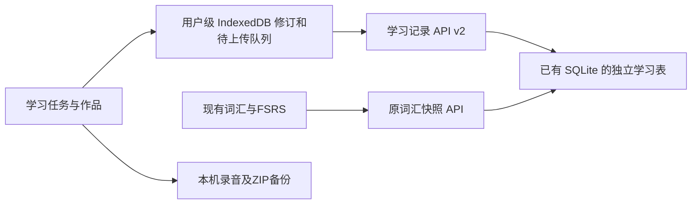

# BandGalaxy 365天全科学习融合实施方案

日期：2026-11-03；计划更新：2026-11-04，Asia/Shanghai。本文是实现边界与数据架构说明；教学安排和阶段验收以[重设计方案](./365-training-redesign-2026-11-03.md)为准，当前阶段结果见[S0交付记录](./365-s0-delivery.md)，课程规则见[R0修正记录](./365-r0-delivery.md)，数据通路见[P1修正记录](./365-p1-delivery.md)。本轮S0后续修正完成后仍待用户复核；新增C/D要求仅列后续设计，未实现运行字段、R1页面或材料齐备。

唯一项目目标是每天固定120分钟、学习365天后取得雅思学术类正式总分≥8，同时听≥8.5、读≥8.5、写≥7.5、说≥7.5，全部满足才完成。当前四科基线待测。第0周做真题基线，第1个月起练雅思题型、C1核心词与AWL；G1–G3用于按期检查和调整，不替代最终目标。

初始代码参考标签为[V1.2.0-11.3](https://github.com/fangxintai-a11y/yasiENGLISH/tree/V1.2.0-11.3)，对应`f3384e35719b19f38e515f9cb8cfaca7c408f78f`。这是历史源码基线，不是本轮对线上版本的核验。按S0任务书，本轮继承包含P1修正的R0提交4220ae057；S0完成后再交用户复核，尚未部署。

## 1 可交付的学习闭环

学习者从今日任务进入词汇、听力、阅读、写作与口语练习，独立首答后再看提示和解析。系统保存原始作品、题目版本、用时、条件、错因与反馈来源；修改形成新修订，跨天用新题复测。完成行为与考试分数分别记录，不用打卡推算提分。

| 训练 | 复用能力 | 新闭环与完成证据 |
| --- | --- | --- |
| 词汇 | 三轨FSRS、听写、拼写诊断、文章取词、同义练习 | 听读暴露的错词回流，按当天词汇预算练；不把全科120分钟交给词汇排程 |
| 听力 | 音频播放与听写 | Section 1–4题型、首答、重放/提示条件、证据时间段、错因与复测 |
| 阅读 | 取词与同义辅助 | Passage 1–3题型、原文证据、首答、限定条件与误选原因 |
| 写作 | 输入与现有造句经验 | Task 1/2、题图、计时字数、草稿恢复、原稿/修改稿、四项反馈和准确修订引用 |
| 口语 | 录音采集与回听 | Part 1/2/3、原始录音、手工修正转写、反馈与重录链；无ASR也能练 |
| 订正 | 现有错词复习 | 问题来源、跨天新题、周真人校准及任务调整；三连对只证明本轮修正 |

材料等级由基线与实际表现决定。基础补充是支持完成雅思任务的支线，不把所有人锁在初级短文到第三个月。新词先独立尝试，图片/答案按用户操作揭示；测评模式关闭提示，练习重做不覆盖首答。

## 2 固定120分钟与测评安排

| 阶段 | 月份 | 词汇 | 听 | 读 | 写 | 说 | 合计 |
| --- | --- | ---: | ---: | ---: | ---: | ---: | ---: |
| 一：地基 | 第1–3月，周0后开始 | 35 | 25 | 25 | 20 | 15 | 120 |
| 二：技能 | 第4–7月 | 20 | 20 | 20 | 35 | 25 | 120 |
| 三：强化 | 第8–10月 | 15 | 20 | 20 | 40 | 25 | 120 |
| 四：实战 | 第11–12月 | 10 | 单科限时60 + 复盘30 + 弱项20 | | | | 120 |

周一至周五按阶段模板训练；阶段一至三每天均有听读写说。周六固定听读模考90分钟、复盘30分钟。周日写作完整练习60分钟、口语15分钟、自查复盘30分钟、校准交付/登记15分钟。每周向真人提交1篇Task 2和1段口语录音，全年52个周校准批次；Task 1另按计划评阅，完整写作门槛仍需Task 1与Task 2证据。

阶段四周三和周六开始整套模拟流程，听读与写作拆为两天，每天不超过120分钟，明确标为分科模拟，不能宣称验证连续听读写耐力。若将来需要连续全套模拟，应另行调整预算规则，不能把阅读60分钟和写作60分钟之外的听力塞进当天120分钟。口语单列场次和实际条件。

第0周D1听读真题、D2写作真题、D3口语真题与设置、D4–D5试跑、D6周六听读、D7周日写说校准。基线≥6.5时阶段一缩短为2个月；6.0按默认；5.5时延长为4个月并采用词40、听20、读25、写20、说15分钟，合计120；≤5.0先补2–3个月基础，同时保留可完成的雅思题型接触。调整写入计划记录，不改变目标或伪造按期达标；具体动态重排在R1实现。

## 3 目标、门槛与证据

| 门槛 | 时间 | 听 | 读 | 写 | 说 | 总分 | 附加条件 |
| --- | --- | ---: | ---: | ---: | ---: | ---: | --- |
| G1 | 第3月末 | 7 | 7 | 6 | 6 | 6.5 | 写说由真人或正式成绩评估 |
| G2 | 第7月末 | 7.5 | 7.5 | 6.5 | 6.5 | 7 | 同上 |
| G3 | 第10月末 | 8 | 8 | 7 | 7 | 7.5 | 连续2次不同日期、不同材料的完整测评达到要求 |
| G4 | 正式考试 | 8.5 | 8.5 | 7.5 | 7.5 | 8 | 正式成绩，四科与总分全部满足 |

分数缺项保持null，不补零，不从不同日期挑最高分拼出总分。写作Task 1用Task Achievement、Task 2用Task Response；单篇文章不能冒充完整写作分。转写不能证明发音及真实流利度，没有音频证据的维度保持未评估。

来源分为self、rules、ai、human、official。每周校准绑定同一作品修订，分别保存真人、自评和机器意见；偏差≥0.5提示复核原稿，不自动加分或扩大学习量。最终完成判断是纯函数，不存一个随时间自动变真的数据库标记；软件只比较录入来源与分数，不声称核验成绩单真伪。

## 4 独立数据与跨设备同步

沿用现有账号、同源Cookie和SQLite，不新增第二套登录或数据库服务。plan、mission、attempt、essay、speaking、feedback、assessment使用独立学习记录，不能塞回旧Progress快照。旧词汇模块不负责清洗、合并新作品。

| 表 | 主要职责 |
| --- | --- |
| learning_records | 用户、类型、计划、当前修订与删除标记；dataset_id仅为可空来源属性 |
| learning_revisions | 不可变payload、hash、修订链、序号、冲突状态、逐修订dataset_id及payload_version |
| learning_mutation_receipts | 请求指纹、状态及冻结修订引用，不重复保存作文全文 |
| learning_schema_migrations | 学习模块独立迁移版本，不依赖旧模块的PRAGMA user_version |

学习API为`/api/learning/v2/records`、`/changes`和修订历史接口；`GET /api/capabilities`返回`learningRecords:2`与写开关。新写schemaVersion=2，新修订payloadVersion=2；旧记录按版本1原样读。所有API归属由服务端会话决定；保持无缓存、跨用户隔离与原`/api/health`精确语义。

旧plan通过显式业务投影展示新目标，不能原地改历史payload后保留旧hash。旧essay缺taskType不猜为正式Task 2。旧outbox保留原mutationId/body：已接收的先按旧指纹重放，未接收且不合法的隔离，显式修复另建修订。旧v1客户端暂停学习读写、保留本机成果；旧v1接口仅可重放已有回执，不能继续写旧契约。

本机scope仅按用户区分，切换词库不隐藏学习记录。迁移同用户旧词库scope、修订、outbox及录音，核对后才删除旧scope；账号切换不上传前账号的内容。访客作品单独保存，用户明确选择后才并入账号。

400坏记录及413永久体积拒绝移入可重试/导出原文的quarantine并继续无关上传；422保留请求并仅阻塞相关依赖；网络、401及5xx暂停。并发修改保存409冲突副本；解决后产生新修订。游标只在成功提交本机的实际返回修订后推进，迟到响应不覆盖新输入。

### 4.1 后续数据扩展，当前严格v2不接收

本节为未来设计，不是已落库字段。详细结构与验收见[数据契约§6](./365-r0-data-contract.md#6-后续数据扩展设计本轮不实现)；进入相应阶段时先审定版本、前后端schema、SQLite/IndexedDB迁移与共享样例，再接UI，不借notes塞结构化未知字段。

| 规划对象 | 数据与归属 | 资格或兼容规则 |
| --- | --- | --- |
| 材料目录/引用（D1/D2） | materialId/version、materialSource、sourceRef、许可/访问状态与核验日期；materialSource仅official / cambridge / publisher / unofficial | 与现有评分者source完全分开；旧缺失不自动变official。G1–G4及主目标差距仅取official/cambridge且仍符合原测评条件的记录，其他仅参考；G4还必须是同次正式成绩。 |
| 阅读记录（C1–C7） | 材料版本/hash、首答与题目证据；requested/covered/uncovered词ID、匹配器版本作为独立阅读记录元数据 | 刷新、重开与同账号同步保持覆盖信息；旧缺字段为未知，材料改版不覆盖历史。私有正文留本机，只同步允许的引用与学习元数据。 |
| 计划考试形式与熟悉任务（D3） | 所选考试形式、报考地区、官方核验URL/日期；两次熟悉任务引用及实际分钟 | 周0与考前4周分别登记，包含在当天120分钟。不能把某考区的机考/纸笔可用性推广到所有地区。 |
| 考务清单（D4） | 同一有效证件的自查状态、官方出分/EOR/安全入口、核验日期和办理状态 | 不存证件号码/扫描件；出分不写死天数；正式成绩变更新增修订，不覆盖旧分。 |
| 泛读泛听、写作自查、口语练习（D5–D7） | 任务引用、真实分钟、取词；原稿修订上的拼写计数/三项Task 1自查；录音真实时长与练习卡ID | 阶段二/三每周2次泛读/泛听各10–15分钟，取代既有听/读部分预算；练习计数、时长与提醒不换算雅思分。 |
| 写说成绩标签（D8） | 沿用source与原稿修订/hash；未来工作台按来源渲染“估分” | 本地及外部自动/粘贴反馈均为估分，human/official才可作为写说门槛证据；正式完成仍仅official。 |

## 5 录音、草稿与材料

本机草稿频繁保存；明确保存版本或适度云端检查点才产生不可变修订，不逐键上传整篇作文。反馈绑定workRevisionId、inputHash、rubricVersion和source，改稿后旧反馈仍属于旧稿。

文字与录音元数据可同步，原始音频仍在本机IndexedDB。P1提供ZIP导出/导入、完整性校验及去重；每周日真人校准后提醒。另一设备须手工导入音频，未导入时明确显示缺少原件；旧声音日记不自动纳入此ZIP。R3再单列鉴权音频上传、配额、备份和删除设计，不能把Base64音频塞入学习JSON快照。

首发14天材料要有逐日库存、备用池、来源、许可、审校人与版本。内置内容采用自编审校的雅思同等难度样本：阅读约700–900词、完整听力Section、Task 1/2和Part 1/2/3提示。真题用合法外部资源做基线和模考，不复制进仓库；目录链接不算已备齐材料。私有题包可本机导入并记录引用，未上传原件时跨端不假装可打开。

R0样例保留其历史范围；未来R1学术长文训练另按800–900词、4–8段和10–14题验收。R1阅读验收包含至少30主题目录、365独立材料的年度目录目标、连续14次阅读不重复主题、JSON私有/外链导入、目标词至少8/12覆盖、证据位置统计、判断题文序、数字题三类分布和覆盖信息持久化，完整阈值与负例见[总方案§9.2](./365-training-redesign-2026-11-03.md#92-c1c7r1阅读页面计划与验收)。目录目标及合成排程fixture均不代表实际材料已齐，库存按真实就绪状态单列。

官方免费资源入口及考务来源仅收录[总方案§9.3](./365-training-redesign-2026-11-03.md#93-d1d8采纳内容工作包与验收)已核对的IELTS.org、British Council和IDP链接；不搬运题文，权限与考区信息在使用前再次核对。周0选考试形式，机考在周0及考前4周各做官方熟悉测试；写作按实际考试形式计时。Task 1检查总体概述、适当比较和不写个人观点，Part 1练习回答加理由或例子约20–30秒、Part 2练习说满2分钟；这些工作台尚未在本轮实现。

## 6 阶段开发与复核

| 顺序 | 阶段 | 可复核交付 |
| --- | --- | --- |
| 1 | P1修正 | 目标/门槛/Task 1/错因/来源契约、同步隔离、用户级迁移、录音ZIP、请求回执与部署制品 |
| 2 | R0修正 | 继承通过复核的P1；规则配置、真实题型schema、14天库存、逐科样例、预算与内容校验 |
| 3 | S0 | 删除旧直连SDK、Key/模型设置及全部引用；统一可选反馈接口，本地规则与复制/粘贴路径默认本地评分并提供复制提示词 |
| 4 | R1 | 计划启用、今日任务、固定预算、词汇适配、成绩本及外部任务登记；C1–C7阅读页面与B7目标迁移 |
| 5 | R2 | Task 1/2写作工作台、草稿恢复、修订对比与反馈绑定 |
| 6 | R3 | 口语Part 1/2/3、录音/转写/重录、媒体跨端专项评审 |
| 7 | R4 | 听读首答、证据与错因、14天审校材料包 |
| 8 | R5 | 订正、跨天复测、周校准偏差与任务调整 |
| 9 | R6 | 隔离预发、真机/PWA、规模数据、迁移回退及发布候选验收 |

每阶段验证、独立commit、push阶段分支、核对远端SHA后立即停止，等用户复核再开始下一阶段。当前只做S0及约定的日历、音频修正；R1不在本轮范围。阶段分支不能直接合并main或触发生产部署。

B7明确转入R1：**store.ts 默认 targetBand 改为 8，四科目标取 SECTION_TARGETS，旧设置迁移，附测试**。验收覆盖新默认值、旧6.5/缺四科设置、重复迁移、账号切换及旧进度/作品保留；本轮不改store运行代码。

清单的后续工作包名对应为S2写作=R2、S3听读材料=R4、S4口语=R3、S5测评/校准=R5、S6考前与发布准备=R6。D1在S3/S6，D2在S3/S5，D3在周0/阶段四/S6，D4在阶段四/S6，D5在阶段二/三，D6在S2，D7在S4，D8在S2/S4；每项具体验收和官方链接以总方案§9.3为准，不表示已开始这些阶段。

## 7 迁移、制品与发布边界

SQLite模块v2在变更前通过backup API创建一致性备份，再事务迁移、恢复索引与外键检查；历史正文、hash、引用和幂等身份不重写。测试需覆盖真实旧库、迁移重入、失败回滚、旧请求重放与跨词库编辑。

目标生产参数由配置提供，用户给定入口为ibaz.cn:8443、低内存和有限磁盘，本轮未实机核验。预构建模式在构建机生成dist与完整API，目标机只解包、切链接和健康检查，不跑npm；runtime清单必须同时含app.py与learning.py。专用端口、路径、服务名、空间阈值均可配置，不操作443及无关服务。

迁移后不能直接启用旧P1学习后端写入。回退先关闭学习写入、保留当前数据库与本机队列，并检查旧API兼容性；禁止恢复旧库覆盖新成果。缓存客户端遇不支持的能力时保留原稿/outbox，等待兼容版本恢复。生产发布需要独立授权，本轮仅阶段分支交付。

首期完成须同时满足14天材料、本地评分核心练习、跨端文字续接、离线/冲突恢复、账号隔离、录音边界、旧功能回归与真机验收。软件完成、实际学习投入与正式目标达成分别记录；全年材料与52周真人服务不能由P1测试替代。
