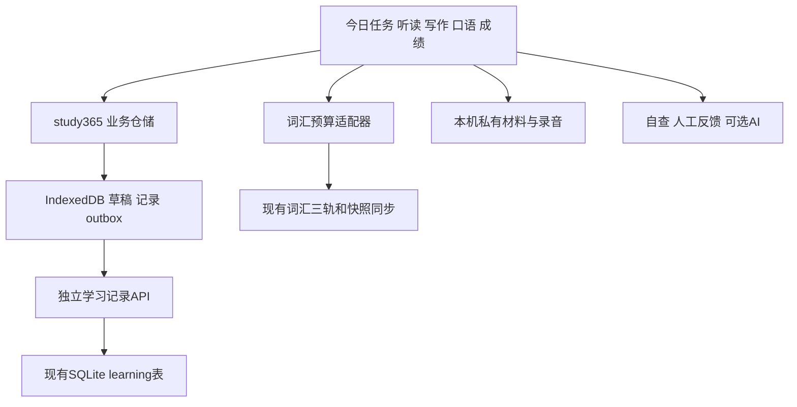

# BandGalaxy 365天训练项目研究与开发重设计

日期：2026年11月3日，Asia/Shanghai。状态：项目目标、数据库路线和逐阶段GitHub交付方式已由用户确认。

项目目标固定为：**让我学习365天之后拿到雅思8分。** 最终成绩要求总分至少8.0，继续保留听说读写各项至少6.5的约束；每天投入120至180分钟。7分和7.5分只作为中间里程碑，不能标记项目目标完成。当前四项基线待测，用于分配训练与选择材料，不预设已经达到6分。

建议保留现有词汇系统与已完成的P1数据通路，优先开发今日任务、分级材料、写说作品、反馈与复测。新HTML中的学习流程有参考价值，S0至S6工程清单需要重新排序；多供应商AI、本地大模型、文本画像和通用FSRS扩展安排在核心训练可用之后。

原HTML及[原实施方案](./365-fusion-implementation-plan.md)保留供对照，本方案作为后续阶段顺序和验收依据。执行方式为：每阶段开发完成后验证，形成独立commit并推送GitHub阶段分支，核对远端SHA，交付链接与验证结果，然后停下等待用户复核。阶段推送与合并main、部署生产分别处理。

## 1 研究范围与当前基线

研究对象是用户提供的本地文件 `ielts-master-plan.html`，共730行；本文的HTML位置均指原文件行号。文件SHA256为 `bff8a7a81746e1c7d93bee486a056c9e115c8cae7f5a8190834ba8cbbf6a3fee`。文中的编程Agent提示词作为待评审内容，没有作为操作指令执行。

研究覆盖HTML可见内容及交互脚本、现有应用和P1源码、官方雅思考试与评分说明、候选开源工具的原始文档。下述代码能力由本机源码确认；本轮P1复验结果另见交付记录。真实手机模型性能与课程提分效果尚未验证，生产站点本次未重新核验。

研究时的代码基线为 `f3384e35719b19f38e515f9cb8cfaca7c408f78f`，对应此前固定的 `V1.2.0-11.3`。P1独立数据通路已提交GitHub，提交和验证范围见[P1阶段交付记录](./365-p1-delivery.md)。用户继续后，当前交付为[R0契约和内容样本](./365-r0-delivery.md)；365业务页面尚未接入。

| 已有能力 | 实际边界 | 重设计处理 |
| --- | --- | --- |
| 词汇旅程、认词/听音/产出三轨、晨间回测、救星 | 现有 `dailyMinutes` 是词汇预算 | 保留；全科预算另存，通过适配器派生当日词汇预算 |
| 约3分钟词汇摸底 | 分层抽样估计本词库认识情况，不是四项雅思诊断 | 保留为学习起点参考，不显示为雅思基线 |
| 单词与短语听写、拼写错因 | 不能代替整段听力理解和整套听力 | 将真实听力暴露的错词回流到这里 |
| 文章取词、词条同义练习 | 不是完整阅读题库或语境推理评估 | 保留为阅读辅助 |
| 造句评分、错词短文 | 当前依赖Claude Key与在线模型；没有HTML所称的本地评分器 | 不把拟开发能力写成现有能力；新核心流程允许无AI练习 |
| 跟读与声音日记 | 识别文本与目标词匹配，不能作为发音分；旧日记按句保存first/last | 复用录音采集，不复用其覆盖策略保存完整口语作品 |
| P1学习记录 | 独立IndexedDB、SQLite记录/修订、outbox、幂等、冲突副本；还没有365业务入口 | 继续接业务，不再重做一套同步 |

可复用的当前词汇资产为7298词、14596条例句、7298张图；标签文件含1672个听写标记、2320个短语、833个AWL词条标记、3568个同义映射条目。这些数量不等于已审校的考试题目或全年课程库存。

对应源码：[P1协议](../src/study365/protocol.ts)、[本机存储](../src/study365/db.ts)、[学习仓储](../src/study365/repository.ts)、[SQLite学习模块](../server/learning.py)、[词汇排程](../src/ielts/exam.ts)、[摸底](../src/ielts/placement.ts)、[现有造句页](../src/pages/ielts/WritingTab.tsx)、[现有错词阅读页](../src/pages/ielts/ReadingTab.tsx)、[录音采集](../src/lib/recorder.ts)、[旧声音日记](../src/lib/voices.ts)。

## 2 对新HTML的评审结论

### 2.1 保留的设计

保留四科真实任务、先独立作答再查看反馈、按错因订正、定期复测、反馈引用原文证据的主线。保留本地完成核心学习、AI按需增强、真人评阅补足写说判断的分层思路。材料导入、计时、作文原稿和录音保存都与用户目标直接相关。

需要将“机器可以计算什么”与“这些数字说明什么”分开。字数和答题时长可以直接计算；结构、用词、停顿等自动分析应显示为工具提示；雅思准备度需要相应的任务与评估证据。

### 2.2 必须修正的问题

| 编号 | HTML位置 | 发现及影响 | 新方案处理 |
| --- | --- | --- | --- |
| F01 | 99、625行及各Sprint公共提示词 | 假定起点约6分未经验证；用户现已明确确认365天8分为项目目标 | 保留8分最终目标，7/7.5仅作里程碑；按四项基线分配训练 |
| F02 | 177行 | 120分钟连续完成听读写，再另加口语，预算不足 | 完整模拟预留180分钟；120分钟日拆分，保留分科测评标识 |
| F03 | 673至688行 | 总分达到8就显示达标；G3文字要求连续两次，代码只查最近一条完整记录 | 总分、单项底线、证据充分性分别判断；稳定性查多次独立材料 |
| F04 | 691至694行 | 成绩只有日期、类型和四个数字，无法追溯题目、原稿、评分者与条件 | 按科关联实际尝试、材料版本与评分来源 |
| F05 | 122、138行 | 用总分决定统一阶段长度；基础阶段就要求C1/AWL学完、整篇阅读高准确率 | 增加基础衔接入口；按具体障碍调整材料与训练 |
| F06 | 533至551、553、566、567、581行 | 把任务、作文、测评等放回旧Progress快照，绕开已完成P1；done取并集还会恢复已撤销完成 | 复用独立学习记录；任务状态与真实尝试分开 |
| F07 | 554、582、610行 | 反馈附在作品上，缺少充分的原稿修订和完整测评引用 | 反馈绑定原稿修订、内容hash与评分标准版本 |
| F08 | 185、223、229、566行 | 宣称语法错误密度、无错句比例等可靠；答案默认宽松处理单复数 | 语法提示保留误报可能；客观题采用逐题审校的答案与限制 |
| F09 | 516至530行 | 先删除现有SDK/Key、做多供应商重构，首周仍没有写说作品流程 | 核心业务优先；旧配置保留，AI渐进适配 |
| F10 | 594、624行 | 承诺录音永不上传，却以Web Speech或服务端识别作降级 | 本机录音为默认；网络音频服务单列、主动开启，不静默切换 |
| F11 | 595至608行 | 加e/g/m前缀即视为统一FSRS，忽略当前词条查找、渲染和耗时依赖 | 先提供再次练习队列；通用条目适配完成后再接FSRS |
| F12 | 185、229、609至622行 | 用更高CEFR替词、词汇占比和句型计数暗示高分 | 建议围绕意思、搭配与论证，取消指标到雅思分的映射 |
| F13 | 102、625行 | 365×2=730小时同时每月留两天缓冲，未说明缓冲是否学习 | 明确计划容量与实际投入；24天完全休息时约682小时 |
| F14 | 182至185、624行 | 将高分语伴与熟悉雅思评分的人混同；差0.5就自动加交，欠缺依据 | 记录评阅者和评分条件，按反馈质量与可用时间决定复核 |
| F15 | 236、624行 | 数据集相关性被用于证明本地指标可靠，部分许可/版本表述合并过粗 | 明确任务和评分域差异，按实际数据包及版本登记授权 |

这些发现是对这份HTML和当前设计的评审，不表示相应问题已经存在于线上版本。

## 3 成功标准与测评规则

### 3.1 最终目标与中间里程碑

| 目标层级 | 判定 | 示例组合 |
| --- | --- | --- |
| 项目最终目标 | 正式考试总分至少8.0，并且四项分别至少6.5 | 听8.5、读8.5、写7.5、说7.5，总分8.0 |
| 中间里程碑 | 总分7.0、7.5用于检查训练进展，不代表项目完成 | 听7.5、读7.5、写6.5、说6.5，总分7.0 |

示例组合用于规划，可以根据诊断调整，不要求只有这一种组合。总分遵循四项平均后按官方规则取整；例如9、9、6、7的平均7.75，显示总分8.0，但单项底线未满足。官方听力与学术阅读8分的平均参考为35/40，具体试卷转换略有差异，37/40不作为所有试卷固定8.5的硬编码。[官方计分说明](https://ielts.org/take-a-test/your-results/ielts-scoring-in-detail)

系统分别显示三种事实：本次完整成绩是否达到总分8及单项6.5、近期独立测评是否支持8分准备度、正式考试是否已实现项目目标。手工录入可以保存；来源不明时不据此宣布达标。缺失分数保持空值，不补零、不拿其他日期最高分拼出一次总分。自评、AI估分、打卡和日历推进均不能触发最终完成；没有正式成绩时最终目标保持待验证。

验收例子：8/8/7/7的总分为7.5，仍在训练；9/9/6/7的总分虽为8，因写作低于6.5仍未满足；8/8/8/8和8.5/8.5/7.5/7.5均满足数值条件，但仍需根据记录来源区分模拟结果与正式达成。

### 3.2 四项基线

前7天安排诊断和试跑，允许分日完成。先用与当前能力相容的短任务找到障碍，再按可完成程度采集完整分项；完整考试过难时保留真实未完成样本，不强行推算分数。

听读保存题目、首答、限时条件和原始分；写作保留独立原稿；口语保留完整录音。原有词汇摸底只辅助选词。没有合格的写说评估时，这两项继续显示“待评估”。

完整写作评估需要Task 1和Task 2，评分时Task 2权重是Task 1两倍。单篇Task 2的分数明确标为该任务评估；短段落不显示写作单项分。完整口语评估需覆盖三部分，并由评阅者听原始录音，不能只读转写。[官方写作结构与权重](https://ielts.org/take-a-test/test-types/ielts-academic-test/ielts-academic-format-writing)、[官方口语描述符](https://ielts.org/cdn/ielts-guides/ielts-speaking-band-descriptors.pdf)

### 3.3 准备度证据

建议采用最近28天内两次不同未见材料、完整分项、限时且无提示的测评作为阶段复核样本。28天与两次是本项目的保守操作规则，不是官方报考资格或可靠性保证。分科在不同日完成时标明日期范围；它反映分项准备度，不能代替连续考试耐力验证。

写说评分保存评阅者、对标准的熟悉程度、四维意见、题目与原稿版本。语伴适合对练和可理解性反馈；重要门槛优先由熟悉雅思评分的人复核。AI估分、自评和单次人工分均保留来源，不把“真人”自动视为无误差的标准答案。

优先处理低于6.5的科目，再围绕总分8及推荐分项组合安排专项。训练建议基于近期多次任务与具体错因；资料不足时给出“先补一份样本”，不自动宣称最弱科。未完成待评阅任务不计零分。

## 4 365天训练与时间预算

### 4.1 日历与学习进度分开

| 日历范围 | 天数 | 初始安排 | 调整依据 |
| --- | ---: | --- | --- |
| D1至D7 | 7 | 基线、工具试跑、材料分层 | 实际听读样本、写说原稿、时间与难度感受 |
| D8至D84 | 77 | 高频词听认、基础句型、短音频、短文与短表达 | 换材料后是否仍能理解和表达 |
| D85至D196 | 112 | 雅思题型衔接、段落到整篇、口语三部分 | 首答条件下的题型表现和输出反馈 |
| D197至D308 | 112 | 围绕8分目标强化完整分项，7/7.5为中间检查点 | 不同材料的完整测评证据 |
| D309至D365 | 57 | 8分准备度验证、针对瓶颈训练与正式考试安排 | 总分、单项、证据稳定性与剩余时间 |
| 合计 | 365 | 课程日历框架 | 不因日期自动提升水平 |

以上是默认任务分布，不是阶段提分预测。材料难度独立于日历位置，允许基础阶段持续更久；未达底线时，后期继续补基础，不把困难内容压缩塞入剩余日期。初始检查点为D7、D14、D28及后续约四周一次，重要节点进行完整分项复核。

词汇训练从常用词的听认、拼写和语境使用起步，复习积压时减少新词。新词上限结合实际用时调整，不以“90天学过全部C1词”作验收。

### 4.2 三档预算

普通日先给出120分钟核心任务，150/180分钟档追加明确的纠错或完整输出任务。初始核心模板如下，可按基线改配比。

| 任务块 | 分钟 | 完成证据 |
| --- | ---: | --- |
| 词汇微练 | 20 | 已有词汇尝试与回忆记录 |
| 主要训练A | 35 | 听力或阅读首答与复盘 |
| 主要训练B | 35 | 句子、段落、作文或口语作品 |
| 跨天纠错 | 20 | 前几天问题的重做、重写或重录 |
| 短休与记录 | 10 | 单独列预算，不算学习作答分钟 |
| 合计 | 120 | 计划容量与实际投入分别统计 |

不强求每天平均切五块。基础期主要训练B可用句子到段落的台阶，后续切到完整写说。150档增加30分钟复盘；180档再增加30分钟专项。整篇写作、整套阅读和模考有专用模板，不按比例把60分钟完整任务缩成20分钟。

补强只能挪动可调整任务。优先保持四项每周覆盖、必要复习与实际反馈时间；不从固定时长的完整测评中扣20分钟，也不在剩余时间不足时给出负预算。某天只能做20至30分钟时标为最低任务日，完成部分保留。

### 4.3 每周模板与模考

| 日 | 主要训练A | 主要训练B | 复盘安排 |
| --- | --- | --- | --- |
| 周一 | 听力 | 基础句型或Task 2段落 | 上周听力错因 |
| 周二 | 阅读 | 口语与陌生追问 | 上周阅读错因 |
| 周三 | 听力 | Task 1或数据描述 | 写作修改 |
| 周四 | 阅读 | 口语与重录 | 词句迁移 |
| 周五 | 近期瓶颈 | 完整输出专用模板 | 为周末检查留材料 |
| 周六 | 同级新材料检查，能力允许时完整听读 | 检查后登记条件 | 复杂错题可移到次日 |
| 周日 | 写说反馈与订正、周复盘 | 安排下周重点 | 缓冲与恢复 |

基础期降低整套测试频率，先保证能完成和复盘；后续建议每四周做一次完整分项检查，临考阶段根据材料库存与恢复情况增加到每一至两周一次。这个频率是初始产品方案，实际使用后调整。未见测评材料单独留存，做过的题可复习，但不再作为新的未见测评。

听力约30分钟、阅读60分钟、写作60分钟，口语11至14分钟；纸笔听力另有誊写安排，软件按所选考试模式与实际题包配置。完整模拟预留180分钟，听读写连续进行，口语可另设场次，详细复盘另日；只有120/150分钟时拆成分科测评，并显示真实条件。[官方考试结构](https://ielts.org/take-a-test/test-types/ielts-academic-test)

全年预算容量为730至1095小时；如果每月两天完全休息，则是约682至1023小时。时间统计只反映投入，不换算预期分数。计划按Asia/Shanghai计算日期；设备时区变化不自动重置学习日。

### 4.4 人工反馈的可执行方式

建议进入完整写作阶段后，每周评阅一篇Task 2，隔周评阅一篇Task 1，并检查一份覆盖口语三部分的录音或进行对练。进入阶段门槛时补齐完整写作评估。频率、费用与周转取决于用户实际可用渠道，系统先支持导出和录入，不默认已经有52次评阅服务。

暂时没有评阅者时，仍可进行自查、改写、回听和AI辅助；写说准备度显示待复核。一次分差0.5不自动增加任务量，优先看对应原稿和具体原因。每次反馈选择一至两个问题，订正后跨天换题再用，避免积压大量未处理批改。

## 5 产品流程与最小可用版本

### 5.1 学习流程

首页展示当前单元、今日预算、三至五项任务和下一步。每张任务卡要回答：做什么、使用哪份材料、做到什么算本次完成、成果是否保存。题目难度、提示是否使用和完成状态可追溯。

完成任务只证明做过相应练习；能独立迁移才支持掌握判断；雅思准备度另由测评决定。连续天数与打卡百分比保留为过程信息，不当成绩。

### 5.2 页面与能力

| 页面 | 首期范围 | 后续增强 |
| --- | --- | --- |
| 今日任务 | 开启计划、预算预览、实际入口、部分完成、最低任务、恢复 | 根据近期证据提出下一周重点 |
| 材料与听读练习 | 具体材料、提交首答、判分、证据、错因、A-B循环 | 更多题型与可选自动对齐 |
| 写作工作台 | 题目与图表、计时、字数、本机草稿、作品修订、自查、反馈归档 | 语法提示与可选AI |
| 口语工作台 | P1至P3计时流程、录音、回听、导出、手动转写和重录关系 | 通过真机验证后的ASR/VAD |
| 复盘页 | 真实问题、来源、订正和跨天再练 | 有类型的复习条目与FSRS适配 |
| 成绩与准备度 | 原始分、来源、条件、8分目标与单项底线 | 多次测评证据与中间里程碑 |

练习模式允许提示和修改，测评模式提交前关闭词义、翻译、语法检查与AI建议，并标记无法阻止的站外辅助。自动保存与自动拼写纠正分开：考试模式保留自动保存，关闭应用提供的语言提示；第三方输入法或浏览器扩展的影响作为测评条件记录。

### 5.3 首期完成定义

交付连续14天能实际使用的基础路径、对应备选与检查材料、365天任务框架，以及完整的保存与复盘流程。必须能在无AI时完成核心任务，手机和电脑能续接文字成果，录音的本机状态明确，未见检查与重复练习分开。

首期不宣称全年内容已齐备，也不宣称软件已经证明365天达到7或8分。完整试卷导入与模拟可以先验证一套样例；全年练习量按后续内容库存验收。

## 6 材料供应与学习有效性

### 6.1 首14天内容清单

| 内容 | 最低拟交付库存 | 审校要求 |
| --- | --- | --- |
| 基础短听力 | 14份主路径，至少2份备用 | 音频与文本一致，3至6题，答案和证据时间段；D7/D14材料保留作检查 |
| 基础短阅读 | 14份主路径，至少2份备用 | 约50至200词起步；主旨与细节题、原文证据，检查池独立 |
| 基础句型 | 14组，每组至少4题 | 支持合理变体；说明句意、词形与搭配要求 |
| 输出主题 | 14组，每组含写与说提示 | 按周选择主要输出，包含示例、自查和变式任务 |
| 完整考试样例 | 1套听读、Task 1/2各1题、口语三部分1组 | 有来源与答案；图表/音频可用；作为导入及流程验证，不冒充全年题库 |

这是发布前需要准备的数量，本次没有制作或审校这些材料。D1、D7、D14使用不同材料，已看答案或转写的任务不能计作未见检查。

材料分为内置自编审校、外部指定链接、用户私有导入三种。外链必须落实到具体标题和页面，目录链接不计库存。外链任务标明联网与手工登记；只有实际缓存并具备使用依据的材料才能显示离线可用。可使用British Council的[分级听力](https://learnenglish.britishcouncil.org/free-resources/listening)与[阅读](https://learnenglish.britishcouncil.org/free-resources/reading)作筛选入口，不将其目录等同于已经备好的课程。

### 6.2 材料契约

每份材料保存稳定ID、版本、技能、任务类型、材料难度、交付方式、来源URL、使用范围、审校者/日期、预计分钟、答案规则、证据引用及资源校验值。试卷另保存Academic/General、纸笔/机考、原始分转换表来源与版本。

客观题按逐题接受答案、词数限制和答案语法判定。可按题包明确规则处理大小写、空白及允许变体，不能默认忽略单复数或所有连字符差异。缺答案、解析不确定或人工复核中的题显示待核对，不报“100%可靠判分”。[官方听力题型要求](https://ielts.org/take-a-test/test-types/ielts-academic-test/ielts-academic-format-listening)

私有导入先支持明确JSON结构与手工答案卡，不以自动PDF/Word解析作为首期依赖；保留来源预览与核对步骤。AI从没有答案的试卷推导出的答案不能自动进入测评答案表。

内容目录同步来源与引用，公共目录只放允许公开分发的内容。私有导入材料整包首期留本机，云端用材料ID、版本与hash引用；必要题目文字及用户选择的短证据属于可同步学习记录，在导入预览中明确列出，不自动复制完整文章、音频或图表。另一设备缺材料时仍可保存或修改已有原稿，内容核验与重新测评提示缺少材料；重新导入相同文件按hash恢复原引用，不重新生成无关联ID。只有成绩同步不能显示为材料已经同步。

每周补齐未来14天可用材料；不足7天时优先补内容或安排明确的巩固任务。全年库存按任务量计算：例如一周一套听读持续一年就要52套独立材料，另外还需要日常训练；重复使用可作学习，不能重复充当未见测评。

### 6.3 学习研究怎样落到功能

间隔与检索研究支持跨天回忆、订正后再次使用；不直接证明本项目固定日程或FSRS参数能带来雅思8分。对完整作文，复习单位更适合是一个可迁移的论证或语言问题，而不是整篇作为一张记忆卡。[间隔研究](https://digitalcommons.usf.edu/psy_facpub/1771/)、[检索研究](https://pubmed.ncbi.nlm.nih.gov/16507066/)

交错练习的经典63%对20%来自数学任务，不能直接外推为雅思必须每篇混题型。初学者先理解示例并集中练习，随后混合辨别，用未练过的材料检验迁移，是本项目需要验证的教学选择。[原研究](https://digitalcommons.usf.edu/psy_facpub/1767/)

范文可用于理解结构、对照修改，再遮住材料进行新题表达；不因“重读效用较低”就取消必要理解。固定重写三次、C1词占比、连接词数量都不作为掌握阈值。问题关闭依据是能解释修正原因、跨天正确使用、换语境仍可完成。

学习效果试跑按两周记录：任务是否过难、真实完成时间、问题是否反复出现、换题首答和独立表达是否改善。单人前后变化用于调整个人计划，不宣称因果提分效果。

## 7 数据与同步架构

### 7.1 复用P1

沿用现有账号与SQLite，不新增第二套登录、Postgres或Redis。现有P1表为 `learning_records / learning_revisions / learning_mutation_receipts / learning_schema_migrations`。作文、口语、任务和成绩不放入旧词汇Progress；旧PWA仍只能接触旧快照。

P1的七类记录继续使用：

| 类型 | 用途 | 需要增量明确的业务内容 |
| --- | --- | --- |
| plan | 总分8及单项6.5、120/150/180预算、开始日、时区、课程版本 | 分项规划组合、路径选择与调整历史 |
| mission | 当日任务、状态与计划分钟 | 引用具体尝试及外部登记证据 |
| attempt | 材料版本、首答、答案、用时与条件 | 题目级判分依据、信心与错因、证据句/时间段 |
| essay | 题目、原稿、修改稿关系 | Task 1/2标识、题图引用、草稿状态 |
| speaking | 题目、转写、录音引用与设备、重录关系 | Part、场次、转写来源与人工修正 |
| feedback | 原稿修订、hash、标准、来源与正文 | 评阅者信息、工具版本、建议的证据片段 |
| assessment | 日期、来源、条件及分数 | 各科尝试引用、Task 1/2完整性、口语范围与复核信息 |

当前协议拒绝未知字段，上表右列并非已经可直接保存。实施前为每阶段列出前后端字段差异、校验规则和读写样例。Task 1的Task Achievement与Task 2的Task Response正确区分；现有bands键未覆盖的字段要显式扩展。

P1尚未发布，首次发布前可以完成统一契约修订并更新临时测试库样例；本地已有试验记录须保留迁移路径。以后发布过的协议若有不能兼容的变更，使用新的能力/协议版本和对应API路径，旧端保留旧读写语义；不让旧客户端接收会因未知字段而中断增量同步的新记录。

### 7.2 草稿与不可变作品修订

编辑器将频繁输入保存在独立本机草稿中，建议停顿约1秒写本机，页面隐藏时尽力刷新；页面突然关闭或操作系统终止仍需恢复提示，不能只依赖beforeunload。只有提交、明确保存版本或适度的云端草稿检查点生成不可变修订；不每按一个键就上传一份整篇作文。

计划的云端草稿检查点可先采用停顿约30秒且内容变化后保存，并允许手动立即同步，实际间隔在R2真机试跑后确定。另一个设备能续接最后已同步版本；在原设备未同步的输入不能宣称已跨端可见。界面分开“已存本机”和“已同步”。

P1当前以每个scope的整对象保存heads/revisions/outbox/cursor。R2用一年规模的合成历史和连续编辑验证读写成本；如果不适合，迁移到按记录/修订索引的object stores，保持修订ID、outbox与游标事务一致，不为性能直接丢历史。增加分页和历史加载入口，避免启动即渲染全年所有内容。

反馈始终引用 `workRevisionId + inputHash + rubricVersion + source`。修改正文后产生新稿，旧反馈仍属于旧稿；迟到AI结果和转写不能覆盖当前输入。冲突由P1保留两份，用户选择或合并后形成新修订。

### 7.3 三类数据的跨端边界

| 数据 | 首期位置与同步 | 另一设备的行为 |
| --- | --- | --- |
| 计划、任务、作答、作文、转写、反馈、测评 | IndexedDB后进入SQLite，沿用P1离线补传 | 登录同账号可回读与继续编辑；未同步状态明确 |
| 录音与私有材料整包 | 独立本机存储，可导出；必要题目文字和用户选定短证据按学习记录同步 | 显示所在设备或缺少文件，不出现虚假的云播放/打开按钮 |
| AI密钥 | 独立设备配置或服务器环境，不进入学习记录 | 需要单独配置，不跟随账号资料传递 |

录音跨设备是后续独立媒体阶段，需要鉴权上传/下载、配额、备份、删除和保留策略。本次不把音频Base64塞进SQLite记录快照；在做跨端录音前，先提供导出与本机存储失败的明确处理。

新增网络音频识别或发音服务时，明确音频接收方与保留范围，由用户主动启用。Web Speech在部分浏览器使用服务端识别，不能作为“永不上传、离线识别”的透明降级。[MDN说明](https://developer.mozilla.org/en-US/docs/Web/API/SpeechRecognition)

## 8 开源组件与AI选型

### 8.1 按增量收益选用

| 组件或项目 | 选择 | 理由与进入条件 |
| --- | --- | --- |
| 当前Word Atlas、ts-fsrs、录音与词形工具 | 继续使用 | 已支撑词汇和基础采集；不替换账号与数据系统 |
| Earthworm | 借鉴词到句的训练与课程编排 | 先挑少量合适题验证迁移，避免整套Vue/后端/账号迁入 |
| Qwerty Learner | 借鉴定向拼写练习 | 当前已有近似能力，优先回流真实错词 |
| IELTS-Studio | 借鉴计时答卷、复盘流程 | 先做少量明确格式导入，答案必须核对，考试模式无提示 |
| Speaking Simulator | 借鉴P1至P3问答流程 | 题目与提示不等于声音评分引擎 |
| my-ielts、openIELTS | 筛选资料与思路 | 按难度、来源与可使用范围入目录，不直接当全年教材 |
| Harper | R5之后可试点 | Worker离线语法提示；误报可忽略；无提示测评时关闭 |
| Transformers.js与Whisper、VAD | 独立技术验证后接入口语 | 录音本身先可用；性能、识别偏差和手机存储通过后启用 |
| WhisperX | 本机内容工具，可后置 | 时间轴允许人工修正；手动A-B标记先满足复盘 |
| ECDICT、额外CEFR词表、compromise | 有具体缺口时再引入 | 先利用现有词库，禁止简单把更高CEFR词当更好表达 |
| jsCAT | 后置 | 算法需要题目参数；缺少标定词汇题库时不能凭接库获得可靠能力估计 |
| LanguageTool、OpenPronounce、KevSun评分模型 | 独立实验范围 | 不进入首期核心后端依赖，不作为达标依据 |
| ELLIPSE、DREsS、speechocean762 | 研究用途，后置 | 用于相关任务研究，不能直接标定雅思写说分 |

参考原始项目：[Earthworm](https://github.com/cuixueshe/earthworm)、[Qwerty Learner](https://github.com/RealKai42/qwerty-learner)、[IELTS-Studio](https://github.com/Pandlagon/IELTS-Studio)、[Speaking Simulator](https://github.com/hubeiqiao/IELTS-Speaking-Simulator)、[my-ielts](https://github.com/hefengxian/my-ielts)、[openIELTS](https://github.com/mcxiaoxiao/openIELTS)。

### 8.2 三项需要验证的技术判断

Harper官方提供WorkerLinter，适合交互应用中把WASM处理移出主线程；它的提示数不等于真实语法错误数。“没有提示”不映射“无错句”。首期先做字数、用时、自查和反馈证据，语法服务的增加由实际错句需求决定。[Harper文档](https://github.com/automattic/harper/blob/master/packages/web/src/routes/docs/harperjs/linting/+page.md)

Transformers.js支持浏览器ASR与WASM/WebGPU路径，但官方并不保证任意手机两分钟音频一分钟内识别完成。原型需测目标iPhone和Android的下载体积、冷/热启动、推理耗时、内存、后台中断和缓存失效，失败时保留录音、回听和手动转写。ASR可能省略填充词或修正重复，VAD也有误检，因此语速/停顿是带测量条件的估计，不能直接换算流利度分。[官方WebGPU指南](https://huggingface.co/docs/transformers.js/guides/webgpu)

OpenPronounce以音频与预期文本比较为主，更适合给定句子的朗读诊断。它需要额外模型及PyTorch、ffmpeg、espeak-ng等依赖，默认gTTS首次处理句子会联网；不能作为轻量SQLite后端几行代码即可获得的雅思自由口语评分。[项目安装与限制](https://github.com/Halleck45/OpenPronounce)

jsCAT的IRT接口需要难度、区分度等题目参数。随意按CEFR标号填难度，无法自动获得标定质量；现有分层摸底保留“粗略起点参考”的定位。[jsCAT接口](https://github.com/yeatmanlab/jsCAT#usage)

### 8.3 评分模型与数据集

KevSun模型卡报告了作者的测试结果，也提供论文；不能直接把0.82理解为对当前用户作文准确率82%。尤其其示例将每个样本输出除以该样本最大值再乘9，当最大值为正时至少一维必为9。接入前必须确认真实输出含义、后处理、题目输入和独立评估集，不能照搬该示例作为生产分数。[模型卡](https://huggingface.co/KevSun/IELTS_essay_scoring)、[论文](https://arxiv.org/abs/2406.01198)

DREsS的评分是1至5范围内的content、organization、language三维，ELLIPSE是另一类英语学习者写作语料。它们可以帮助研究某些文本特征，相关性不能证明工具已能按雅思0至9四维准确评分。[DREsS作者说明](https://haneul-yoo.github.io/dress/)、[ELLIPSE作者仓库](https://github.com/scrosseye/ELLIPSE-Corpus)

引入前登记具体库版本、模型权重、声音、词表和数据包的来源与授权。Transformers.js和原始Whisper不是同一个许可对象，Whisper原仓库为MIT；ELLIPSE当前README列CC BY 4.0，实际使用时仍锁定数据包附带说明及版本证据，不将整个组件和数据清单笼统标为许可已核对。[Whisper许可](https://github.com/openai/whisper/blob/main/LICENSE)、[ELLIPSE当前说明](https://raw.githubusercontent.com/scrosseye/ELLIPSE-Corpus/main/README.md)

### 8.4 AI最小接入

先做“复制题目与原稿→外部AI→回填反馈”，推理依赖外部服务，页面本地校验和归档。再按需要接一个经过验证的服务端或直连提供方。现有AI功能逐步通过适配器接入，不先删SDK或清除旧Key。

本地检查、自评、AI意见、人工评阅与正式成绩保留不同来源和不同语义，不强制共用一个带bands的结果结构。没有证据的维度允许空值；转写文本不产生发音分，也不独立产生真实流利度分。AI改写标为修改示例，不能宣称经考官认定的8分范文。

回填结果做结构、长度和原文引用校验；引用不在原稿中时提示无法核对，不能只通过JSON Schema就接受其结论。图表题需提供图表/可核对数据，只有用户文字转述时注明数据核验范围。

未来多提供方接入时，每个任务先显示发送目的地，密钥绑定origin；改服务地址不携带旧Key。取消终止整次任务，不自动转给下一家；超时涵盖响应体读取，修复重试有次数与费用上限，不对不确定结果盲目重试。网络失败保留原稿和待反馈状态，不阻塞任务完成。

## 9 分阶段实施

### 9.1 阶段边界

下表是P1以后的新顺序。估算是一名熟悉项目的全栈开发者的工程人日，包含相关验证；不含已做P1、全年材料创作审校、人工评阅和用户等待复核的时间。合计约24至39人日，需在R1/R2后重估，不承诺13周日历工期。

| 阶段 | 工程量 | 可复核交付 | 停下条件 |
| --- | ---: | --- | --- |
| R0 契约和内容样本 | 1至2 | 前后端字段差异、14天库存清单、四科各一份样例、预算和目标规则 | 样例可执行，范围和保存字段明确后停下复核 |
| R1 今日任务与成绩本 | 4至6 | 计划启用、120/150/180预算、词汇适配、外部任务登记、8分目标与成绩列表 | 用户能开启计划、做一天并在另一设备回读后停下 |
| R2 写作工作台 | 4至6 | Task 1/2题目与图表、草稿恢复、计时字数、修订对照、自查与反馈绑定 | 断网写、重开恢复、跨端改稿与冲突均能演示后停下 |
| R3 口语作品 | 3至5 | P1至P3流程、录音回听导出、手动转写、重录与反馈 | 不依赖ASR完成练习，真机保存失败及跨端状态准确后停下 |
| R4 听读与14天材料 | 6至10 | 明确格式导入、首答判分、提示隔离、证据错因、A-B循环、14天审校包 | 不同难度路径能完成听读闭环，材料库存验收后停下 |
| R5 订正与任务调整 | 3至5 | 跨天再练、问题来源、周复盘、弱项建议、手动AI回填 | 一份反馈能进入订正和新题复测，建议可解释后停下 |
| R6 首期交付验收 | 3至5 | 隔离预发、完整流程、迁移/回滚与真机证据、候选发布材料 | 满足首期完成定义后停下，由用户复核上线 |

每阶段完成后都须提交并推送GitHub，再停下复核；仅本地可演示不能标为阶段已交付。R1在材料未内置时允许明确登记站外完成，不能把待开发入口标为已可自动完成。内容准备贯穿各阶段，R4之前已为后续14天库存工作；不等到界面完成后才找教材。

### 9.2 GitHub阶段交付规则

1. P1数据底座已以 `0177152579e22c0cf40287db9bffcfcb66ae7d6f`提交到 `codex/ielts-365-p1-data`。用户继续后仅推进R0，R0提交推送后再次停止，不自动开始R1。
2. 后续分支依次使用 `codex/ielts-365-r0-contract`、`codex/ielts-365-r1-daily`、`codex/ielts-365-r2-writing`、`codex/ielts-365-r3-speaking`、`codex/ielts-365-r4-practice`、`codex/ielts-365-r5-review`、`codex/ielts-365-r6-acceptance`。后阶段继承用户已复核的前阶段提交，不各自从旧main重复起步。
3. 每阶段保留独立commit，记录实际完成范围、相关测试结果和仍未验证的条件。推送后用远端查询确认分支SHA等于本机提交，向用户交付分支/提交链接与验收方式。
4. 交付后立即停止；用户复核后才进入下一阶段。修正当前阶段仍在该阶段分支新增提交，不重写已推送历史。
5. 推送阶段分支不等于合并main或上线。当前main推送会触发GitHub Pages自动发布，阶段开发不直接推main；合并与部署另行按用户指示执行。

R6之后再分别评审Harper、ASR/VAD、媒体跨端、通用FSRS条目与更多AI提供方。增强项有独立试验和退出条件，不阻塞主学习流程。

### 9.3 模块与拟修改文件

新增业务继续集中在 `src/study365/`，以下是职责划分，实施时可按实际代码合并小文件，避免空壳层级。

| 模块 | 主要职责 | 对应阶段 |
| --- | --- | --- |
| goals.ts、assessment.ts | 总分8、单项6.5、中间里程碑、逐科证据与准备度 | R1 |
| curriculum.ts、budget.ts、vocabAdapter.ts | 日历/单元/难度、预算、词汇派生设置 | R1 |
| content.ts、contentSchemas.ts、仓库根目录public/curriculum365/ | 内容版本、库存、私有引用与检查池 | R0/R4 |
| drafts.ts、ui/Writing.tsx | 高频草稿、作品检查点与写作界面 | R2 |
| ui/Speaking.tsx、recordingAdapter.ts | 录音采集、作品保存与回听 | R3 |
| practice.ts、ui/Listening.tsx、ui/Reading.tsx | 首答、逐题规则、错因与证据 | R4 |
| review.ts、ui/Review.tsx、feedback.ts | 订正任务、原稿反馈与回填 | R5 |
| protocol.ts、db.ts、repository.ts、server/learning.py | 按阶段完善校验、迁移及必要存储性能 | 各业务阶段按需 |
| App.tsx、router.ts、Today.tsx、Learn.tsx | 入口、页面路由、词汇会话一致预算 | R1起 |

现有 `src/ielts/ai.ts`、词汇Progress、同步合并与FSRS保持原职责；本期不把新作品合并逻辑放进去。服务端已有完整运行文件清单，新增模块必须进入候选制品启动验证。

### 9.4 下一阶段具体工单

后续重新开始开发时，先复核P1，再完成R0契约准备；R0交付后停下复核，通过后仅启动R1。R1不包含本地模型、多供应商重构或复杂文本评分。

| 工单 | 范围 | 完成证据 |
| --- | --- | --- |
| R1-01 目标与测评契约 | 总分8、单项6.5，7/7.5作里程碑；逐科分数来源与缺项；字段差异前后端对齐 | 9/9/6/7底线未达；8/8/7/7未达8分目标；缺项不算总分；AI分不判最终完成 |
| R1-02 365日期和预算 | 日历、单元、材料难度分离；120/150/180与专项模板；恢复/最低任务 | 日期覆盖恰为365天；各模板求和一致；切到D365不增加成绩 |
| R1-03 词汇适配 | 首页预览、开始按钮、Learn会话使用同一预算；旧会话可继续 | 计划开启/关闭两种路径正确；不把全科120分钟全给单词 |
| R1-04 今日任务 | 任务状态、具体材料或明确外部做法、部分完成与撤销 | 反复完成/撤销不虚增分钟；真实尝试保留 |
| R1-05 成绩列表和来源 | 保存基线、分科检查、人工评阅和正式分；关联条件 | 看得到原始分与评估来源；不以最近一次手填四分替代可靠评估 |
| R1-06 跨端演示 | 使用P1保存任务和测评；账号隔离与离线恢复 | 临时账号/SQLite中桌面与手机上下文回读，保留outbox与冲突路径 |

阶段交付说明列明实现、验证、未完成与限制，并给用户一个可操作流程及GitHub提交链接。完成R1后推送分支并停止，不自动进入R2、不自动发布。

## 10 验收与后续发布

### 10.1 学习行为验收

| 场景 | 通过条件 |
| --- | --- |
| 用户几乎不认识当前材料的词 | 能切基础材料，保留原样本，不强行要求完整难题 |
| 看提示、重放、已知答案后做对 | 作为练习保存，不覆盖首次作答条件 |
| 写作仅完成Task 2或口语只有一小段 | 明确局部评估，不当完整写作/口语分 |
| 总分8但某项6 | 总分数值保留，单项底线显示未满足 |
| 分差、缺项或人工意见不同 | 展示来源和证据，不自动加分、补零或拼接最高成绩 |
| 订正同一个句子多次 | 计为再练；需换题迁移证据才关闭问题 |
| 120分钟日进入完整模拟 | 明示需180分钟模板或拆为分科，不缩短真实试卷 |
| 365天已到或连续打卡 | 不自动提升难度、分数或宣布目标完成 |

### 10.2 数据与设备验收

重点沿用P1的离线、响应丢失幂等、409冲突、换账号、旧客户端与回滚场景，再补业务流程：断网写作及重开恢复、迟到响应不覆盖新稿、旧反馈归旧稿、录音Blob保存失败不伪成功、另一设备缺录音/材料状态准确。

私有材料导入要有类型和大小限制、schema校验与配额失败提示；未知字段不静默接受。备份与同步排除密钥，普通反馈按文本或安全组件渲染。首次公开发布前按锁定版本核对使用的外部依赖及资源说明。

真实iPhone与Android验证输入、键盘、录音、回听、导出、离线重开和缓存；手机尺寸浏览器模拟不能代替真机证据。性能门槛在具体设备与样例上约定，不能只写“任意中端机一分钟完成”。

每阶段运行与改动相关的单元、后端与浏览器检查，完成仓库要求的 `npm test / npx tsc -b / npm run test:server / npm run build`。账号写入与迁移使用隔离数据库，生产学习记录不写测试数据。各阶段仅报告实际运行结果，本轮P1结果见阶段交付记录。

### 10.3 发布与回滚边界

沿用当前项目维护流程：GitHub固定提交→本机核对与打包→上传核验→服务器构建候选制品→预发验收→切换。开发阶段不直接修改生产。未来发布前重新核验当前运维说明、生产提交和数据路径，不依赖本次静态基线。

迁移先做一致性备份，新增后端能力就绪再开放前端入口；计划由用户主动启用。回滚切代码与入口，不用旧数据库覆盖新学习成果。缓存新前端遇旧API时保留草稿/outbox，显示暂不可同步。

每阶段完成GitHub交付后停止，等待用户复核；当前阶段状态见R0交付记录，下一轮只启动明确复核通过的阶段。
